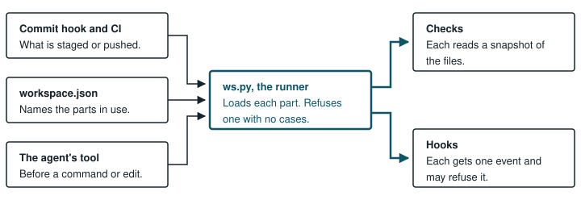

# agent-ready-workspace

A small, working workspace for coding agents. It holds what neither the model nor the code knows, and it checks that what it holds stays true. Python standard library only, no install step.

A model brings general skill. A repository says what the code is today. Neither knows which service is the live one, what your team calls things, or how you have agreed to finish work. A workspace writes that down. Where a machine can check one of its rules, a part checks it, and the table below says which rules those are and which stay prose. Adding a check means adding one part: a file, its cases and a line in the manifest.

<picture>
  <source media="(prefers-color-scheme: dark)" srcset="assets/parts-dark.svg">
  
</picture>

The longer description of the pattern is at [ryantornberg.com/workspace](https://ryantornberg.com/workspace/). This repository is the smallest version that runs. The team and the order system in its examples are invented.

## Try it

```
python3 ws.py --version     # the engine's version, which the manifest must name
python3 ws.py list          # the parts this workspace uses, and the phases each check runs in
python3 ws.py selftest      # every part's own cases
python3 ws.py check         # run the checks on this repository
python3 -m unittest discover -b tests
```

Then watch it refuse something:

```
echo '{"version": 1, "path": "src/orders-service-v1/OrderService.cs"}' | python3 ws.py hook before-edit   # refused, exit 2
echo '{"version": 1, "prompt": "List every caller."}' | python3 ws.py hook before-handoff   # names no tier
echo '{"command": "ls"}' | python3 ws.py hook before-shell                # no version: refused, it fails closed
echo '{"version": 1, "command": "git add -A"}' | python3 ws.py hook before-shell    # a reminder, exit 0
python3 tools/symbols.py ReconciliationWorker src                         # file and line
```

Rename the class in `src/orders-api/ReconciliationWorker.cs` and `python3 ws.py check` fails, because the index still sends agents to the old name. Edit `docs/playbooks/fix-a-bug.md` and it fails again, because the playbook no longer matches its last passing eval run. Both changes are easy to undo with `git checkout`.

To run the checks before every commit, and on every commit message:

```
git config core.hooksPath .githooks
```

## What is here

| Path | What it is |
|---|---|
| [AGENTS.md](AGENTS.md) | The contract: the rules and facts every agent reads, in one file for every tool. |
| [INDEX.md](INDEX.md) | Topics, and a table that maps everyday words to the names the code uses. |
| [workspace.json](workspace.json) | The manifest: which parts this workspace runs, and their settings. |
| `ws.py`, `wslib/` | The engine. `wslib/` holds all of its code: the runner and the small core the parts plug into. `ws.py` only starts it. |
| [parts/](docs/parts.md) | Six checks and three hooks, each one file plus its cases. |
| [docs/](docs/definition-of-done.md) | The definition of done, one playbook, three decision records, the question log, the orchestration rules, and the templates and plan for the current milestone. |
| [evals/](evals/README.md) | Three eval cases in a small sample order system, and 45 recorded runs per arm of a real model: with the workspace's guidance, with a two-line instruction instead, and with neither. |
| `tools/symbols.py` | Returns the file and line where a name is defined. |
| [src/](src/README.md) | A few sample code files for the checks and hooks to act on. |

## What is checked, and by what

| Rule | Enforced by | When |
|---|---|---|
| A link points at a real file and heading. | `links` check | Commit, CI |
| Whoever edits a page past its review date reviews it. `AGENTS.md`, `INDEX.md` and every page under `docs/` carry a date. | `freshness` check | Commit, CI |
| An alias in the index, and a code name in backticks in `AGENTS.md`, name something the code still defines. | `aliases` check | Commit, CI |
| A playbook, `AGENTS.md`, `INDEX.md`, the eval harness and anything else an eval case covers change only with a new eval run on record, in which the guidance beats the bare model on at least one grader. A stored grade that does not follow from its transcript fails. | `eval_record` check; `evals/grade.py --recorded` | Commit, CI; CI |
| No file, commit message, author or committer holds a term from the maintainer's private deny list. | `deny_list` check | Commit, on a machine that has the list |
| A commit holds only files the agent session wrote. | `edit_ledger` check, against the paths the edit tools wrote | Commit, while an agent session has edits waiting |
| Files are staged by name, never all at once. | `no_stage_all` hook, a reminder that never refuses | Before a shell command |
| A shelved folder is not edited. | `shelved` hook | Before an edit |
| A task handed to a helper names its tier, and runs at the model and effort the manifest binds to it. | `handoff_tier` hook | Before a helper starts |
| A hook refuses an event it cannot read, and the wiring refuses when Python is missing. | The runner and `wslib/launch.sh` | Every hook call |
| A part's own cases pass, at the level each finding states. | The runner | Every command that loads the part. A hook call loads only the hooks for its event. |
| A part leaves the manifest only when it is retired with a reason. | The runner | Commit, CI |
| The manifest names the engine's version, gives a reason for every part, binds every tier to a model and an effort, and holds no unknown key. | The runner | Every command. A hook call checks the version and the tiers only, so a missing reason cannot lock a session out. |

The commit check reads the staged pages, the staged manifest and the staged parts with their cases, not the folder, so another session's unsaved edits to them cannot make a commit pass or fail. It reads them all in one batch, so it starts three git processes however many files the workspace holds. The working-folder check, `check`, starts from the same git listing and adds the untracked files git does not ignore, so the two see the same files. The page checks read the pages the workspace owns: a page inside a code repository under `src/`, and a symbolic link, are left out. A page that is not UTF-8 is an error; code in Windows-1252 or UTF-16 is read. The core in `wslib/` still runs from disk. CI runs the same checks on Linux, macOS and Windows, with a token that can only read, and compares with the commit before the push, so a teammate who never installed the hook is still caught. The one exception is `deny_list`, which needs a private list that CI does not have. When CI has nothing to compare with, such as a first push or a force push, it treats every file as changed. CI also runs once a week with no push, to catch what changes without a commit, and runs the checks for the nightly phase then.

These rules in [AGENTS.md](AGENTS.md) and the [definition of done](docs/definition-of-done.md) stay prose, because nothing here can check them: open pull requests as drafts and merge only after CI passes, write a goal and non-goals for larger work, log the questions you had to ask, compare build warnings with the base branch, and list the callers you checked. The eval tests two more, see a test fail before editing and mark claims as verified, and whether an agent acts on the contract's facts.

## Add a part

A part is one Python file and one file of cases. [docs/parts.md](docs/parts.md) has the two interfaces and a worked example of each. In short:

```python
# parts/no_empty_pages.py
from wslib.parts import finding

KIND = "check"


def run(snapshot, config):
    return [finding(path, 1, "this page is empty")
            for path in snapshot.paths(suffixes=(".md",))
            if not (snapshot.read(path) or "").strip()]
```

```json
[{"name": "an empty page fails", "files": {"a.md": "", "b.md": "# B"}, "expect": ["this page is empty"]}]
```

Save the cases as `parts/no_empty_pages.cases.json`, add `{"use": "no_empty_pages", "why": "an empty page tells an agent nothing"}` to `workspace.json`, and it runs at commit and in CI. A check that sets `PHASES = ("nightly",)` runs only in `python3 ws.py check --phase nightly`. Without the cases file, or with a case that fails, the runner refuses to load it.

## The eval

[evals/](evals/README.md) asks whether the guidance changes what an agent does, and whether it beats something cheaper. It gives a real model one-line requests in a small order system, in three arms: with the workspace's guidance, with a two-line instruction that asks for the playbook's two habits, and with neither. One request is the Export bug. The other two use the team's own words, "the nightly job" and "the big report", where the tempting fix sits in the shelved folder or in another report.

In the recorded runs, fifteen per arm in each of the three cases on a small model, 43 of 45 guided runs passed every grader, 14 of 45 two-line runs and none of the 45 bare runs. The two lines produced the habits they ask for as reliably as the playbook. The difference came from the facts: every two-line and bare run that heard "the nightly job" changed the shelved folder, and 27 of 30 that heard "the big report" changed the wrong report, while every guided run changed the right code. The cases were built so that those facts matter, by the same hand as the guidance, so this shows that the contract and the index reach the agent, not how often real work turns on them. [evals/README.md](evals/README.md#the-recorded-runs) has the table, the intervals and the transcripts.

## Use it for your own team

1. Replace the facts in `AGENTS.md` with the ones a model gets wrong about your code. Leave out anything it gets right from the code alone.
2. Put your code repositories under `src/` as submodules, and remove the samples. Add `submodules: true` to the checkout step in `.github/workflows/ci.yml`. The checks do not read the pages inside them, so their own links and dates do not fail yours.
3. Fill the alias table from the words your team actually says.
4. Write a playbook for the task you repeat most, and one eval case for it.
5. Start the question log. Each entry is a gap; fix the page, then note the fix.

Add a part when the same mistake shows up twice.

## Limits

- **`symbols.py` reads C#, TypeScript and JavaScript one line at a time.** It finds types, methods, constructors, properties, functions and constants declared on one line in the usual style. It is a lookup for names you already know, not a parser. It misses a declaration split across lines or behind an attribute; C# fields, events, delegates, indexers and operators; TypeScript class fields, getters, one-line method bodies and CommonJS exports; Python module-level constants; and anything generated at build time. It can report a declaration that sits inside a multi-line string.
- **`links` reads the common ways to link**: inline links and images, reference definitions, and HTML `href`, `src`, `srcset`, `id` and `name`. It does not read autolinks, headings inside list items, headings produced by HTML tags, or the second candidate in a `srcset`. It checks links inside HTML comments and indented code blocks, and it reads `a[0][1]` in prose as a reference link; put such text in backticks. A line over 10,000 characters is reported as an error, not read. Its anchors follow GitHub's rules as I understand them; another renderer may differ.
- **The checks prove that nothing is dangling. They cannot prove a page is true.** A page that contradicts last week's decision passes every one.
- **The hooks are wired for two agent tools**, Claude Code ([.claude/settings.json](.claude/settings.json)) and Codex CLI ([.codex/hooks.json](.codex/hooks.json)), each through its own adapter in `wslib/events.py`. Another tool's payload is refused until it has an adapter and its own few lines of wiring. The wiring runs `wslib/launch.sh`, which needs a POSIX shell; on Windows that is the bash that comes with Git. When it finds no Python, or is missing itself, every call is refused.
- **Under Codex CLI, less is proven and less is enforced.** One recorded run of codex-cli 0.169.0 ([tests/records/codex-cli-run.json](tests/records/codex-cli-run.json)) shows three things: the reminder on `git add -A`, the sweep refused at the commit, and a patch into the shelved folder refused. A test replays its hook payloads. Nothing else has been run under Codex.
  - Codex runs a project's hooks only after you trust the project and review its hooks with `/hooks`. Until then no hook runs, and only the commit check guards staging.
  - By Codex's own documentation, a hook that times out, or replies in a shape Codex does not read, lets the call go ahead. The wiring sets a 30-second limit, and the runner replies only with an exit code or the documented reminder. If a hook is skipped this way, nothing else stops an edit to the shelved folder; the commit check still refuses a sweep.
  - Codex edits through one patch tool. A patch that touches several files is refused when any one of them is in the shelved folder, and then none of its files is recorded.
  - A Codex subagent is refused: no recorded run yet shows where its payload holds the task, so its tier cannot be checked.
  - The wiring finds the workspace from the top of the git repository the session started in. A session started inside a code repository under `src/` has every call refused.
- **`edit_ledger` knows only what the edit tools wrote.** The runner records each path an agent's edit tool is allowed to write, in a ledger kept inside the working copy's git folder. With no ledger open, as for a person's own commit, the commit is not compared. While one is open, a file a shell command or a generator wrote must be recorded by name, with `python3 ws.py ledger --add PATH`, and a person's own commit is refused until the agent commits its edits or the person runs `python3 ws.py ledger --close`. A commit closes the paths it holds through the post-commit hook. It guards against accidents: `git commit --no-verify` skips it, CI has no ledger to compare with, and during a merge, cherry-pick, revert or rebase it warns instead. See [decision 0002](docs/decisions/0002-hooks-remind-the-commit-enforces.md).
- **`no_stage_all` reads a command line, and only reminds.** It follows separators, new lines, subshells, `sh -c`, `eval` and common wrappers, and it skips heredoc bodies and quoted text. A command built by a script, held in a variable, hidden in an alias or piped into a shell gets past it, and it cannot tell that `git add src` names a whole folder. When it fires, the agent sees the reminder next to the command's result, and the runner opens the edit ledger of the session's working copy if that copy has uncommitted changes. The eval's check on what was actually committed does not depend on it.
- **`shelved` guards the edit tools only.** A shell command that writes into the folder, such as `sed -i` or `git mv`, does not pass through it. An edit through a symbolic link into the folder is refused, because the runner follows links, and so is one through a name the file system folds to the same folder: another case, a long s for an s, or a trailing dot or space on Windows. An edit through a hard link to one of its files is not, and nor is one in another working copy of the workspace, such as a worktree nested inside it.
- **`handoff_tier` sees only the tool's delegation call.** It reads the tier from the first line of the prompt and compares the model and effort the task sets. A helper that runs at the caller's model whatever it sets, such as a fork of the session, gets past the model comparison, and a helper started some other way, such as from a script, is not seen at all.
- **`aliases` is strict about its table and loose about what counts.** Each row needs exactly two columns, the second one plain name in backticks; a linked name or a second table under the heading is an error. Any definition of that name under `src/` satisfies it, including a method that happens to share the name. In `AGENTS.md` it takes only backticked words that mix upper and lower case, such as `AccountFreeze`, so `main`, `KIND`, `max_age_days`, paths and commands are not checked.
- **The commit check reads a submodule from its checkout on disk**, not from the commit the index pins. Run `git submodule update` before committing a pin change, and initialise submodules before the first check.
- **`eval_record` trusts the record file.** It shows that someone ran the cases on the current wording. It cannot stop a person from editing the record by hand; CI's re-grade catches a grade that does not follow from its transcript, not a transcript written by hand. Changing a playbook, `AGENTS.md`, `INDEX.md` or the harness means running all three cases again, 135 agent runs; moving a page's review date in its front matter does not.
- **Review dates run out.** Every dated page here was reviewed on the same day. About six months later a first push or a force push, where CI treats every file as changed, fails until the pages are reviewed and their dates moved.
- **The eval is three cases on one model, fifteen runs per arm in each.** `evals/run.py` drives one agent tool, Claude Code, inside that tool's own sandbox; another tool would need a sandbox or a container, and none is built. The guided arm is given the pages, not the hooks.

## License

MIT. See [LICENSE](LICENSE).
